<div align="center">

# CryptEnv

**Encrypted environment secrets management for local development, CI, and production.**

Secrets are stored as AES-256-GCM ciphertext, isolated by workspace, project, and environment
(`DEVELOPMENT` / `STAGING` / `PRODUCTION` / custom), and delivered at runtime through the dashboard,
CLI, VS Code extension, or SDKs. No plaintext `.env` file is ever written to disk.

[](LICENSE)
[](https://www.npmjs.com/package/cryptenv-cli)
[](https://www.npmjs.com/package/cryptenv-sdk)
[&color=C71A36&logo=apachemaven)](https://central.sonatype.com/artifact/io.github.maheshshinde9100/cryptenv-sdk)
[](https://marketplace.visualstudio.com/items?itemName=maheshshinde9100.cryptenv)

[Dashboard](https://cryptenv-dashboard.vercel.app/) · [Repository](https://github.com/maheshshinde9100/CryptEnv) · [Report an Issue](https://github.com/maheshshinde9100/CryptEnv/issues)

</div>

---

## Preview

<div align="center">
  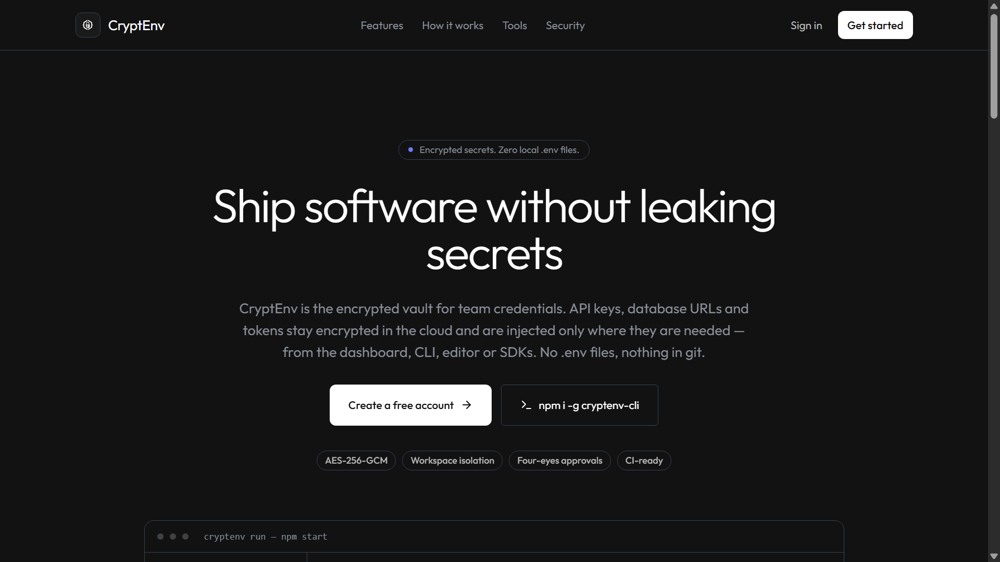
  <p><em>CryptEnv Dashboard — landing page</em></p>
</div>

---

## Live Products

| Product | Link | Notes |
|---|---|---|
| Dashboard | [cryptenv-dashboard.vercel.app](https://cryptenv-dashboard.vercel.app/) | React vault UI, docs, audit log |
| API | `https://cryptenv-backend.onrender.com/api` | Spring Boot control plane |
| CLI (npm) | [npmjs.com/package/cryptenv-cli](https://www.npmjs.com/package/cryptenv-cli) | `npx cryptenv-cli` |
| Node SDK (npm) | [npmjs.com/package/cryptenv-sdk](https://www.npmjs.com/package/cryptenv-sdk) | Optional client-side decryption |
| Java SDK (Maven Central) | [central.sonatype.com/artifact/io.github.maheshshinde9100/cryptenv-sdk](https://central.sonatype.com/artifact/io.github.maheshshinde9100/cryptenv-sdk) | `io.github.maheshshinde9100:cryptenv-sdk` |
| VS Code Extension | [CryptEnv – Secrets Manager](https://marketplace.visualstudio.com/items?itemName=maheshshinde9100.cryptenv) | Secrets Explorer with JWT / API-key auth |
| Python SDK | [`cryptenv-sdk/python`](cryptenv-sdk/python) | In-repo client, v1.0.0 |

---

## Table of Contents

- [Why CryptEnv](#why-cryptenv)
- [Capabilities](#capabilities)
- [Architecture](#architecture)
  - [System context](#system-context)
  - [Backend modules](#backend-modules)
  - [Deployment topology](#deployment-topology)
- [Security model](#security-model)
  - [Encryption hierarchy](#encryption-hierarchy)
  - [Ciphertext formats](#ciphertext-formats)
  - [Authentication and authorization](#authentication-and-authorization)
  - [Email verification](#email-verification)
  - [Password reset](#password-reset)
  - [Google sign-in](#google-sign-in)
- [Data model](#data-model)
- [Secret lifecycle](#secret-lifecycle)
- [Rotation and approvals](#rotation-and-approvals)
- [Provider integrations and sync](#provider-integrations-and-sync)
- [Runtime injection](#runtime-injection)
- [Quick start](#quick-start)
- [Environment variables](#environment-variables)
- [Verification email troubleshooting](#verification-email-troubleshooting)
- [API surface](#api-surface)
- [Repository layout](#repository-layout)
- [Build and test](#build-and-test)
- [Deployment](#deployment)
- [License](#license)
- [Developer](#developer)

---

## Why CryptEnv

Plaintext `.env` files leak through git history, screenshots, CI logs, cached build artifacts, and
shared machines. Rotating a leaked key is often manual, slow, and untracked.

CryptEnv removes the file from the equation:

- Every value is encrypted at rest with AES-256-GCM before it reaches the database.
- Access is scoped per workspace, project, and environment — not per repository checkout.
- Runtime injection puts secrets straight into a child process environment, in memory only.
- Every read, write, rotation, and permission change lands in an append-only audit trail.
- Integrations can sync secrets outward to the platforms a team already deploys on.

---

## Capabilities

| Area | What ships today |
|---|---|
| **Vault** | Workspaces → projects → environments; typed secrets; versioning; branches; import/export; secret references |
| **Cryptography** | AES-256-GCM; PBKDF2-HMAC-SHA256 workspace-key derivation (`v2:` format); optional AAD binding; optional envelope encryption of data keys; master-key rotation |
| **Identity** | Email + password, JWT access/refresh with rotation and reuse detection, TOTP MFA with recovery codes, account lockout, email verification, password reset by emailed code, Google OAuth 2.0 sign-in, OAuth connections, CLI device-code login, WebAuthn credentials |
| **Access control** | Workspace-scoped roles, invitations, JIT access requests, access reviews, step-up MFA for sensitive actions, scoped API keys and machine identities |
| **Governance** | Audit log, approval workflows for writes/deletes/rotations, webhooks, notifications, outbox events, SSE stream |
| **Detection** | Drift detection between vault and synced platforms, leak findings, security incidents, posture score |
| **Integrations** | 50+ provider catalog (source control, deployment, cloud, notifications) with encrypted tokens, sync jobs, retries, dead-lettering |
| **Clients** | Dashboard, CLI, VS Code extension, Node / Java / Python SDKs |

---

## Architecture

### System context

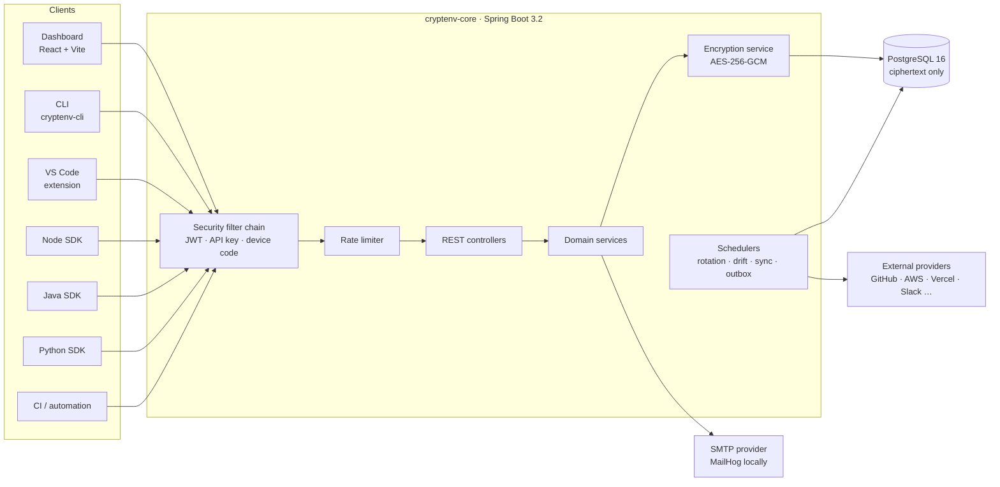

### Backend modules

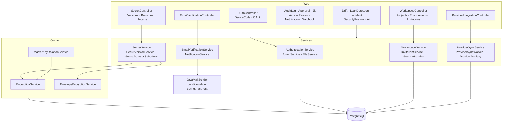

### Deployment topology

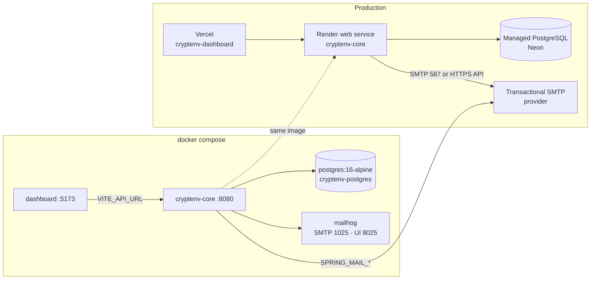

---

## Security model

### Encryption hierarchy

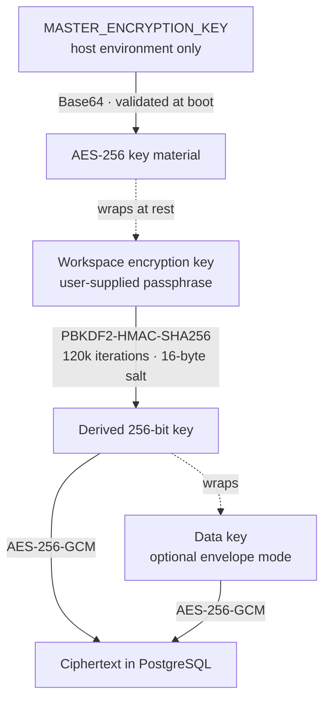

- The master key never leaves the host environment. `EnvValidationConfig` fails startup if any of the
  five required variables is missing, and verifies the master key decodes to at least 32 bytes.
- Each workspace owns its key. Without that key, ciphertext rows are undecryptable even with direct
  database access.
- Rotating the master key does not re-encrypt secrets directly; it re-wraps workspace key material,
  after which each workspace key must be re-set.

### Ciphertext formats

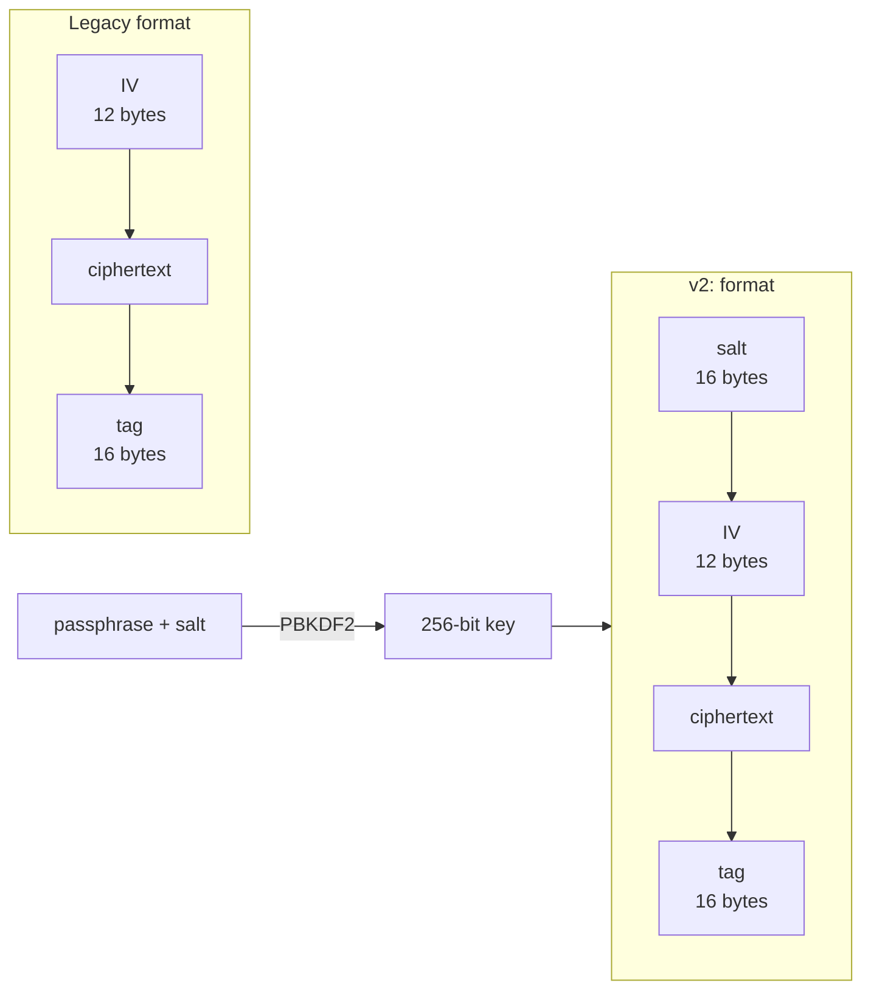

`v2:` payloads derive the key per ciphertext, so every value gets unique key material. New writes use
`v2:` when enabled; readers accept both formats, which keeps the Node, Java, and Python SDKs
compatible during migration. AAD binding is applied as `secretId:envId:version` (or
`workspace:env:key:version`) so a ciphertext moved to another row fails authentication.

### Authentication and authorization

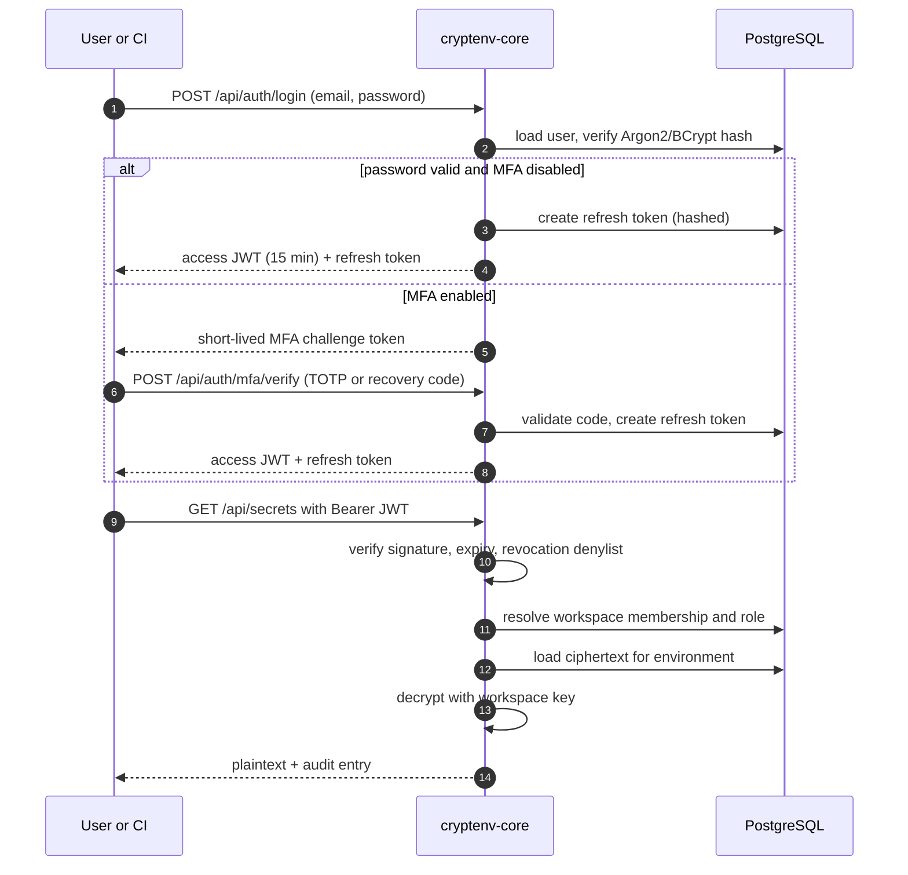

API keys follow the same path but resolve to a scoped, hashed credential, and are rate-limited
separately. Step-up MFA issues a five-minute token that is required for reveal, delete, rotate, and
production writes.

### Email verification

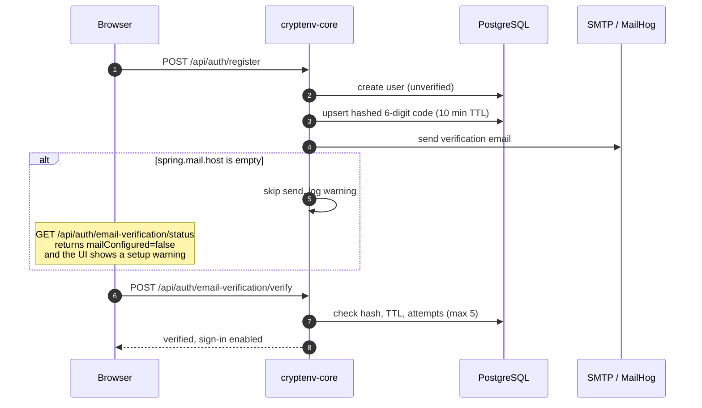

The status endpoint exists so the sign-up UI can warn before a user waits for mail that will never
arrive. See [Verification email troubleshooting](#verification-email-troubleshooting).

### Password reset

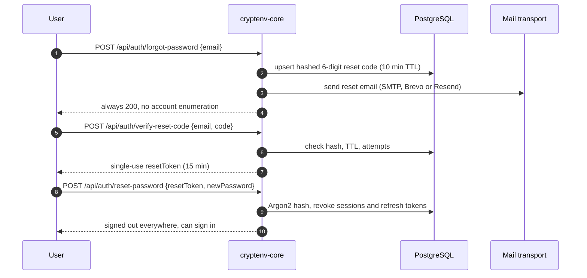

The dashboard exposes the same flow at `/forgot-password`; the CLI uses `cryptenv forgot-password`
and the extension ships `CryptEnv: Reset Password`.

### Google sign-in

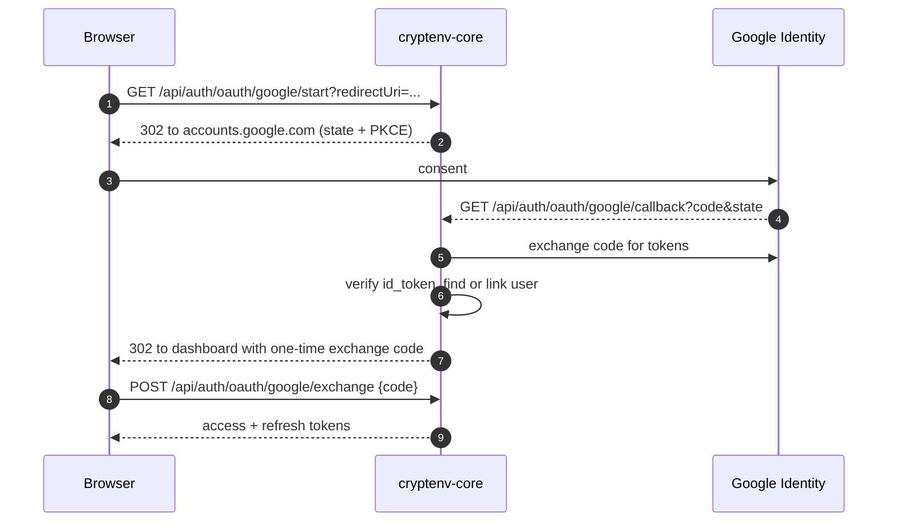

Configure `GOOGLE_CLIENT_ID`, `GOOGLE_CLIENT_SECRET` and `GOOGLE_REDIRECT_URI`; the redirect must be
registered verbatim in Google Console. `CRYPTENV_DASHBOARD_URL` decides where the browser lands
after the callback, and `CRYPTENV_OAUTH_ALLOWED_ORIGINS` can whitelist extra front-end origins.

---

## Data model

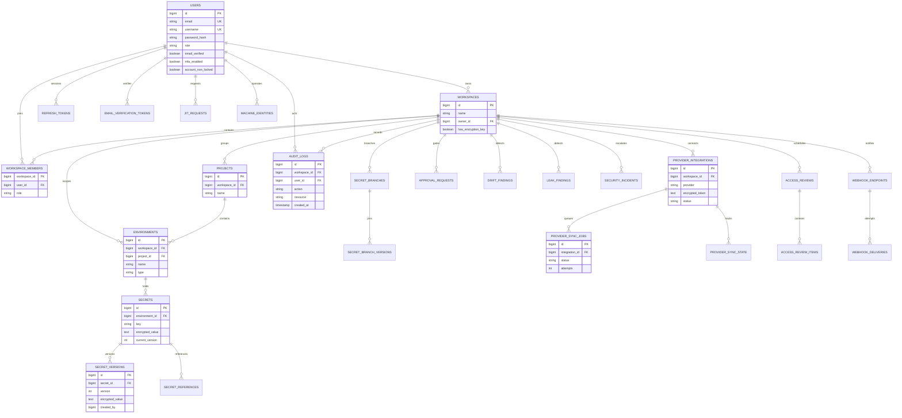

Workspace membership is the authorization boundary: a single user can be an owner in one workspace
and a viewer in another, and roles are resolved per request.

---

## Secret lifecycle

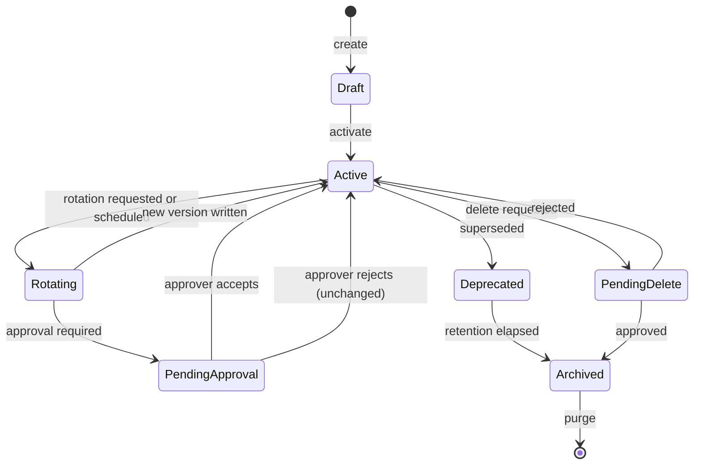

Every transition writes an audit entry, and destructive or production-scoped transitions can require
step-up MFA plus an approval request depending on workspace policy.

---

## Rotation and approvals

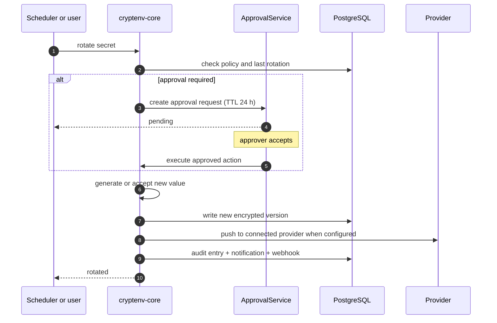

Rotation never overwrites a value with a placeholder: when no generator is configured the secret is
marked stale instead, and the dashboard surfaces it under drift and posture views.

---

## Provider integrations and sync

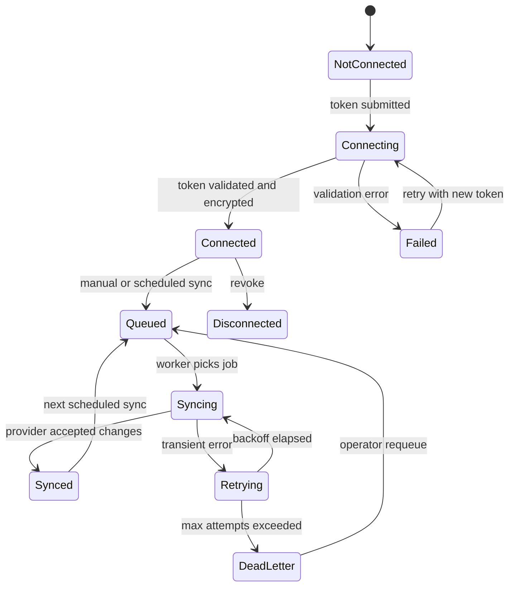

The catalog covers source control (GitHub, GitLab, Bitbucket), deployment (Vercel, Netlify, Railway,
Fly.io, Render, Heroku), cloud (AWS, Google Cloud, Azure, DigitalOcean, Cloudflare, Supabase,
PlanetScale), and notifications (Slack, Discord, Teams, PagerDuty, Opsgenie), among others. Tokens are
encrypted with the master key before storage, and sync jobs are persisted so worker restarts do not
lose work.

---

## Runtime injection

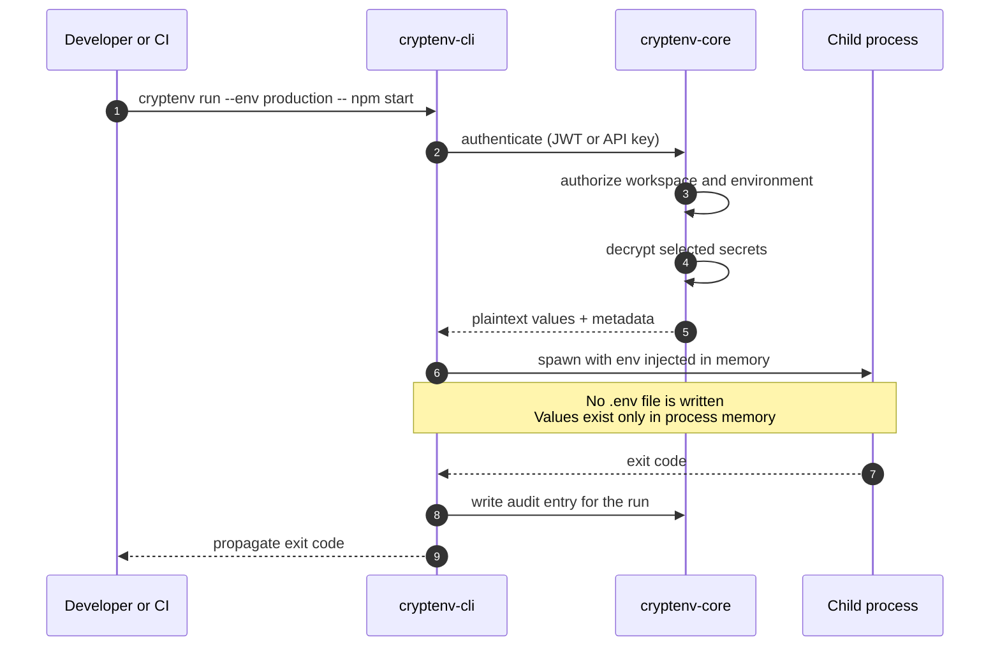

The same contract is available from the SDKs, which can decrypt client-side with the workspace key so
the server only ever returns ciphertext.

---

## Quick start

### Docker (recommended)

```bash
git clone https://github.com/maheshshinde9100/CryptEnv.git
cd CryptEnv
docker compose up --build
```

| Service | URL |
|---|---|
| Dashboard | http://localhost:5173 |
| API | http://localhost:8080/api |
| MailHog inbox | http://localhost:8025 |
| PostgreSQL | localhost:5432 (`cryptenv` / `cryptenv_password`) |

Compose already sets `SPRING_MAIL_HOST=mailhog` and `SPRING_MAIL_PORT=1025`, so verification emails
are captured by MailHog instead of being sent. Register an account, open
http://localhost:8025, and copy the six-digit code from the message.

### Manual

```bash
# 1. Database and local mail
docker compose up -d postgres mailhog

# 2. Environment
cp .env.example .env
# fill JWT_SECRET and MASTER_ENCRYPTION_KEY, then load it into your shell
export $(grep -v '^#' .env | xargs)

# 3. Backend
cd cryptenv-core
./mvnw spring-boot:run

# 4. Dashboard (new terminal)
cd cryptenv-dashboard
npm install
npm run dev
```

Generate the two cryptographic values once:

```bash
openssl rand -hex 32     # JWT_SECRET
openssl rand -base64 32  # MASTER_ENCRYPTION_KEY
```

The API refuses to start when either value is missing, too short, or not valid Base64 — this is
intentional, so a deployment cannot silently run with weak keys.

---

## Environment variables

| Variable | Required | Purpose |
|---|---|---|
| `DB_URL` | yes | JDBC URL, must start with `jdbc:postgresql://` |
| `DB_USER` | yes | Database user |
| `DB_PASS` | yes | Database password |
| `JWT_SECRET` | yes | Signing key, at least 32 characters (`openssl rand -hex 32`) |
| `MASTER_ENCRYPTION_KEY` | yes | Base64 of at least 32 bytes (`openssl rand -base64 32`) |
| `PORT` | no | HTTP port, default `8080` |
| `SPRING_MAIL_HOST` | no* | SMTP host; without it verification email is not delivered |
| `SPRING_MAIL_PORT` | no* | SMTP port (`1025` MailHog, `587` STARTTLS) |
| `SPRING_MAIL_USERNAME` / `SPRING_MAIL_PASSWORD` | no* | SMTP credentials for hosted providers |
| `SPRING_MAIL_PROPERTIES_MAIL_SMTP_AUTH` | no* | `true` for authenticated SMTP |
| `SPRING_MAIL_PROPERTIES_MAIL_SMTP_STARTTLS_ENABLE` | no* | `true` for STARTTLS |
| `CRYPTENV_NOTIFICATIONS_FROM` | no | From address, default `no-reply@cryptenv.local` |
| `CRYPTENV_NOTIFICATIONS_FROM_NAME` | no | Sender display name, default `CryptEnv` |
| `CRYPTENV_MAIL_PROVIDER` | no | `smtp`, `brevo`, `resend` or `none`; auto-detected when unset |
| `BREVO_API_KEY` | no | Brevo HTTPS API key; use when the host blocks SMTP ports |
| `RESEND_API_KEY` | no | Resend HTTPS API key; alternative to Brevo |
| `CRYPTENV_EMAIL_DNS_CHECK` | no | Validate signup email domains over DNS, default `true` (fails open when DNS is unavailable) |
| `GOOGLE_CLIENT_ID` | no | Google OAuth 2.0 web client id |
| `GOOGLE_CLIENT_SECRET` | no | Google OAuth 2.0 web client secret |
| `GOOGLE_REDIRECT_URI` | no | Must exactly match the Authorized redirect URI in Google Console |
| `CRYPTENV_DASHBOARD_URL` | no | Dashboard URL that receives the OAuth result, default `http://localhost:3000` |
| `CRYPTENV_OAUTH_ALLOWED_ORIGINS` | no | Extra origins allowed to receive the OAuth redirect |
| `CORS_ALLOWED_ORIGINS` | no | Comma-separated dashboard origins |
| `JWT_EXPIRATION` / `JWT_REFRESH_EXPIRATION` | no | Token lifetimes in milliseconds |
| `CRYPTENV_FLYWAY_ENABLED` | no | Run migrations at startup, default `true` |
| `CRYPTENV_ENVELOPE_ENCRYPTION_ENABLED` | no | Wrap per-secret data keys, default `false` |
| `CRYPTENV_APPROVALS_ENABLED` / `_TTL_HOURS` | no | Approval workflow, default on, 24 h |
| `CRYPTENV_WEBHOOKS_ENABLED` | no | Outbound webhooks, default `true` |
| `CRYPTENV_NOTIFICATIONS_ENABLED` | no | In-app and email notifications, default `true` |
| `CRYPTENV_DRIFT_STALE_DAYS` | no | Days before a secret is considered stale, default `30` |
| `RATE_LIMIT_ENABLED` / `RATE_LIMIT_TRUST_PROXY` | no | Per-IP limiting; enable trust proxy only behind a known proxy |

\* Required for a usable sign-up flow; the application boots without SMTP so that local development
and API-only deployments remain possible.

Never commit real values. `.env*` is ignored; only `.env.example` is tracked.

---

## Verification email troubleshooting

**Symptom:** registration succeeds, but the code never arrives and verification says
`Invalid or expired verification code`.

**Cause:** no SMTP host is configured, so `JavaMailSender` is not created and the service logs
`Email verification is pending ... because SMTP is not configured`.

**Fix, local:**

```bash
docker compose up -d mailhog
SPRING_MAIL_HOST=localhost SPRING_MAIL_PORT=1025 ./mvnw spring-boot:run
```

Open http://localhost:8025 to read the message.

**Fix, hosted:** set `SPRING_MAIL_HOST`, `SPRING_MAIL_PORT`, `SPRING_MAIL_USERNAME`,
`SPRING_MAIL_PASSWORD`, and enable auth and STARTTLS. Most providers require an app password rather
than the account password. If the platform blocks outbound port 587 — Render does — Brevo's relay
also answers on **2525**, which is usually open: `SPRING_MAIL_PORT=2525`. Alternatively skip SMTP
entirely and use `CRYPTENV_MAIL_PROVIDER=brevo` with `BREVO_API_KEY`, or
`CRYPTENV_MAIL_PROVIDER=resend` with `RESEND_API_KEY`; both send over HTTPS. Verify the sender in
the provider dashboard and put its address in `CRYPTENV_NOTIFICATIONS_FROM`.

**Where the values come from:** `cryptenv-core/.env.production` is read at startup by the
application itself, but only for variables that are **not already set in the real environment**.
Local runs therefore need nothing else; Render, Railway and Docker do not receive that file
(gitignored, excluded by `.dockerignore`), so the same keys must be entered in the host's
environment settings or passed with `docker compose --env-file cryptenv-core/.env.production`.
`java -jar target/*.jar` must run from `cryptenv-core` for the file to be found.

**Reading the startup log:** the API prints the transport it resolved, so a misconfigured mail
setting is visible immediately:

```
EnvValidation: email transport = SMTP (smtp-relay.brevo.com:2525)
EnvValidation: mail sender = you@yourdomain.com (SMTP username set)
EmailSender SMTP target: smtp-relay.brevo.com:2525 (username set, STARTTLS)
Mail handed to smtp transport for user@example.com (Your CryptEnv verification code)
```

A line such as `Mail delivery via smtp failed ...` names the transport error, and
`No email transport is configured` means no host and no API key reached the process.

**Fix, hosted OAuth:** Google sign-in needs `GOOGLE_CLIENT_ID`, `GOOGLE_CLIENT_SECRET` and
`GOOGLE_REDIRECT_URI`. The redirect URI is
`<backend>/api/auth/oauth/google/callback` and must be listed verbatim in Google Console →
APIs & Services → Credentials → OAuth client → Authorized redirect URIs. After the callback the
backend hands the session to `CRYPTENV_DASHBOARD_URL`; add any additional front-end origins to
`CRYPTENV_OAUTH_ALLOWED_ORIGINS`.

**Check without sending mail:**

```bash
curl http://localhost:8080/api/auth/email-verification/status
# {"mailConfigured":true}
```

The sign-up UI calls the same endpoint and shows a configuration warning when it returns `false`.
Codes expire after 10 minutes and allow five attempts; request a new code from the verification
screen if needed.

---

## API surface

All routes are under `/api`. Authentication is a Bearer JWT or API key unless noted.

| Group | Base path | Highlights |
|---|---|---|
| Auth | `/auth` | register, login, refresh, logout, MFA, forgot-password, verify-reset-code, reset-password, email-check |
| Email verification | `/auth/email-verification` | verify, resend, status (public) |
| Google OAuth 2.0 | `/auth/oauth/google` | `start`, `callback`, `exchange` (public) |
| Device code / OAuth | `/auth/device-code`, `/auth/oauth` | CLI login, external identity |
| Workspaces | `/workspaces` | CRUD, members, keys, invitations |
| Projects | `/workspaces/{id}/projects` | project grouping |
| Environments | `/environments` | per-project environments |
| Secrets | `/secrets` | CRUD, reveal, bulk import/export, references |
| Versions | `/secrets/{key}/versions` | history and rollback |
| Lifecycle | `/secrets/{key}/lifecycle` | deprecate, archive, purge |
| Branches | `/secret-branches` | branch-scoped secret sets |
| Governance | `/approvals`, `/access-reviews`, `/jit` | approvals, reviews, just-in-time access |
| Audit | `/audit-logs` | append-only activity trail |
| Detection | `/drift`, `/leaks`, `/incidents`, `/security-posture` | drift scans, findings, incidents, score |
| Integrations | `/integrations` | provider catalog, connect, sync, jobs |
| Automation | `/automations`, `/webhooks`, `/notifications` | rules, deliveries, preferences |
| SDK support | `/sdk` | ciphertext delivery for client-side decryption |
| Streaming | `/sse`, `/events` | live updates and outbox events |
| Operations | `/health`, `/master-key-rotation` | health probe, key rotation |

Interactive docs are available at `/swagger-ui/index.html` when `SPRINGDOC_ENABLED=true`.

---

## Repository layout

```
CryptEnv/
├── cryptenv-core/         Spring Boot API, Flyway migrations, Dockerfile
├── cryptenv-dashboard/    React (Vite + Tailwind) dashboard, landing page, docs
├── cryptenv-cli/          Command-line client, runtime injection
├── cryptenv-vscode/       VS Code extension — Secrets Explorer
├── cryptenv-sdk/
│   ├── node/              npm package with optional client-side decryption
│   ├── java/              Maven Central artifact
│   └── python/            Python client
├── docs/assets/           README imagery
├── docker-compose.yml     Local PostgreSQL, MailHog, API, dashboard
└── .env.example           Environment template (placeholders only)
```

### Dashboard routes

| Route | Purpose |
|---|---|
| `/` | Landing page |
| `/overview` | Workspace overview and activity |
| `/workspace` | Workspace and project management |
| `/secrets`, `/secrets/:key/history` | Vault, editor, version history |
| `/members` | Membership and invitations |
| `/integrations` | Provider catalog and sync status |
| `/rotation`, `/drift`, `/security-health` | Rotation queue, drift, posture |
| `/access-requests`, `/access-reviews`, `/incidents`, `/leaks` | Governance and detection |
| `/audit`, `/notifications`, `/settings` | Audit trail, preferences, account |
| `/docs/*` | In-app documentation |

---

## Build and test

```bash
# Backend
cd cryptenv-core
./mvnw clean verify

# Dashboard
cd cryptenv-dashboard
npm ci
npm run lint
npm run build

# CLI and Node SDK
cd cryptenv-cli && npm ci && npm test
cd cryptenv-sdk/node && npm ci && npm test

# Java SDK
cd cryptenv-sdk/java && ./mvnw test

# Python SDK
cd cryptenv-sdk/python && pip install -e ".[test]" && pytest
```

Flyway migrations are numbered `V1`–`V55` and run automatically when `CRYPTENV_FLYWAY_ENABLED=true`.
JPA runs with `ddl-auto=validate`, so a schema drift fails startup instead of silently altering
tables.

---

## Deployment

1. Provision PostgreSQL and set `DB_URL`, `DB_USER`, `DB_PASS`.
2. Generate `JWT_SECRET` and `MASTER_ENCRYPTION_KEY`; store them as host environment variables.
3. Configure SMTP so registration can complete.
4. Deploy `cryptenv-core` (the included Dockerfile builds a Java 17 runtime image).
5. Deploy `cryptenv-dashboard` with `VITE_API_URL` pointing at the API and add its origin to
   `CORS_ALLOWED_ORIGINS`.
6. Rotate the master key only through `/api/master-key-rotation`, then re-set each workspace key.

The backend does not ship hardcoded fallbacks for secrets; a misconfigured deployment fails fast with
a list of missing variables rather than starting insecurely.

---

## License

Apache License 2.0 — see [LICENSE](LICENSE).

---

## Developer

**Mahesh Shinde** — creator of CryptEnv (Spring Boot, React, CLI, VS Code, Java, Node and Python SDKs).

| | |
|---|---|
| Portfolio | [maheshshinde-dev.vercel.app](https://maheshshinde-dev.vercel.app) |
| LinkedIn | [linkedin.com/in/maheshshinde9100](https://linkedin.com/in/maheshshinde9100) |
| GitHub | [github.com/maheshshinde9100](https://github.com/maheshshinde9100) |
| Email | [maheshshinde9100@gmail.com](mailto:maheshshinde9100@gmail.com) |
| npm — CLI | [cryptenv-cli](https://www.npmjs.com/package/cryptenv-cli) |
| npm — SDK | [cryptenv-sdk](https://www.npmjs.com/package/cryptenv-sdk) |
| Maven Central | [cryptenv-sdk (Java)](https://central.sonatype.com/artifact/io.github.maheshshinde9100/cryptenv-sdk) |
| VS Code | [maheshshinde9100.cryptenv](https://marketplace.visualstudio.com/items?itemName=maheshshinde9100.cryptenv) |
| Dashboard | [cryptenv-dashboard.vercel.app](https://cryptenv-dashboard.vercel.app/) |
| Repository | [github.com/maheshshinde9100/CryptEnv](https://github.com/maheshshinde9100/CryptEnv) |
