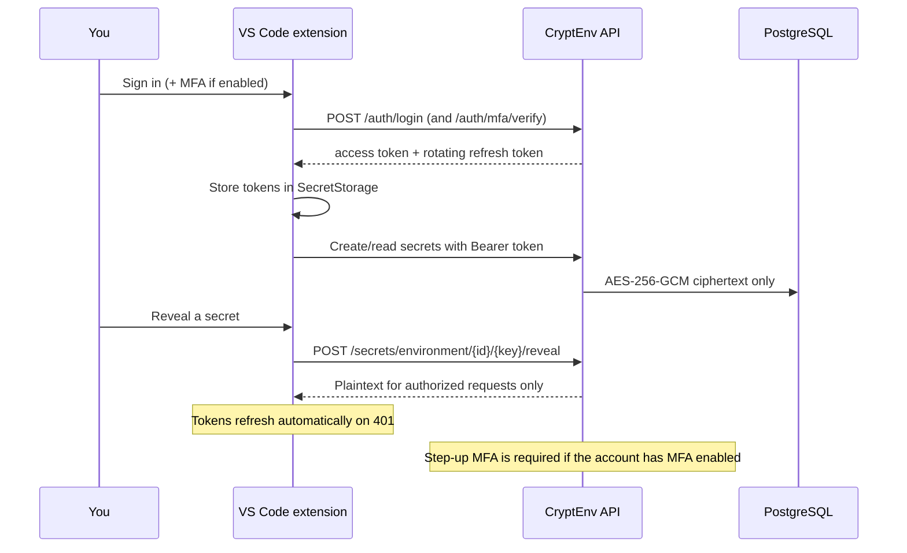

# CryptEnv — Secrets Manager for VS Code

<p align="center">
  
</p>

<p align="center">
  <strong>AES-256-GCM encrypted secrets in your editor. No .env files, no plaintext in the repo.</strong>
</p>

<p align="center">
  <a href="https://marketplace.visualstudio.com/items?itemName=maheshshinde9100.cryptenv">
    
  </a>
  <a href="https://marketplace.visualstudio.com/items?itemName=maheshshinde9100.cryptenv">
    
  </a>
  <a href="LICENSE">
    
  </a>
  <a href="https://cryptenv-dashboard.vercel.app/">
    
  </a>
</p>

<p align="center">
  <a href="https://marketplace.visualstudio.com/items?itemName=maheshshinde9100.cryptenv">Marketplace</a> &middot;
  <a href="https://cryptenv-dashboard.vercel.app/">Dashboard</a> &middot;
  <a href="https://github.com/maheshshinde9100/CryptEnv">Repository</a> &middot;
  <a href="https://github.com/maheshshinde9100/CryptEnv/issues">Issues</a>
</p>

---

## Version 1.5.0

Browse workspaces, environments and secrets from the Activity Bar, then preview, copy, or insert values at your cursor. Credentials stay in VS Code SecretStorage; secret values are encrypted at rest with AES-256-GCM and only decrypted for authorized requests.

The extension talks to the hosted CryptEnv API by default:

```text
https://cryptenv-backend.onrender.com/api
```

Self-hosted backends are supported through the `cryptenv.backendUrl` setting or **CryptEnv: Set Backend URL**.

---

## Highlights

| Area | What you get |
| --- | --- |
| **Authentication** | Email/password sign-in, TOTP MFA and recovery codes, API keys, automatic token refresh, server-side sign-out |
| **Account recovery** | Create Account verifies the email in-editor; **Verify Email** resends codes; **Reset Password** completes the emailed-code flow |
| **Workspaces** | Create, browse and delete workspaces; per-workspace encryption key (16–512 chars); warnings when a key is missing |
| **Environments** | DEVELOPMENT, STAGING, PRODUCTION and custom environments |
| **Secrets** | Create, edit, preview, copy, insert and delete encrypted key-value pairs; version history in the dashboard/API |
| **MFA-aware reveal** | Values are fetched from the audited reveal endpoint; accounts with MFA enabled are prompted for a step-up TOTP code |
| **Editor workflow** | Insert a key or decrypted value at the cursor from the command palette or right-click menu |
| **Storage** | JWT, refresh token and API key use VS Code SecretStorage; only the backend URL is kept in global state |
| **Self-hosting** | Point the extension at any compatible CryptEnv backend in one setting |

---

## Install

From the Marketplace:

1. Open **Extensions** (`Ctrl+Shift+X` / `Cmd+Shift+X`).
2. Search for **CryptEnv - Secrets Manager**.
3. Install and open the CryptEnv icon in the Activity Bar.

From a VSIX:

```bash
code --install-extension cryptenv-1.5.0.vsix
```

Requirements: VS Code 1.85 or newer; a CryptEnv account and backend (hosted or self-hosted).

---

## Quick start

1. Open the **CryptEnv** view in the Activity Bar.
2. Choose **Sign In** (or **Create Account**).
   - New accounts receive a 6-digit verification code and are verified inside the editor.
   - Accounts with MFA enabled are prompted for a TOTP or recovery code.
3. Click **Create Workspace**, enter a name, and set a workspace encryption key. Keep this key safe — every secret in the workspace is wrapped with it.
4. Right-click the workspace → **Create Environment**.
5. Right-click the environment → **Add Secret**.
6. Click a secret to preview it, or right-click to copy, insert the key, or insert the value at the cursor.

Use **CryptEnv: Refresh Explorer** at any time to re-sync from the server.

---

## Commands

| Command | Purpose |
| --- | --- |
| `CryptEnv: Sign In` | Password sign-in with MFA challenge support |
| `CryptEnv: Create Account` | Register, validate the email, and enter the verification code |
| `CryptEnv: Verify Email` | Resend a verification code and verify it later |
| `CryptEnv: Reset Password` | Request a reset code, verify it, and set a new password |
| `CryptEnv: Sign Out` | Revoke the session on the server and clear local credentials |
| `CryptEnv: View Profile` | Show email, username, API key prefix; regenerate the API key |
| `CryptEnv: Set API Key` | Authenticate with a long-lived API key |
| `CryptEnv: Set Backend URL` | Point at a self-hosted backend (adds `/api` automatically) |
| `CryptEnv: Refresh Explorer` | Reload workspaces, environments and secrets |
| `CryptEnv: Create Workspace` | Create a workspace with an encryption key |
| `CryptEnv: Delete Workspace` | Delete a workspace and everything inside it |
| `CryptEnv: Set Workspace Encryption Key` | Set or rotate the workspace encryption key |
| `CryptEnv: Create Environment` | Add an environment to a workspace |
| `CryptEnv: Delete Environment` | Delete an environment and its secrets |
| `CryptEnv: Add Secret` | Store an encrypted key-value pair |
| `CryptEnv: Edit Secret` | Update a value and description |
| `CryptEnv: Delete Secret` | Delete a secret |
| `CryptEnv: Preview Secret` | Show the decrypted value with copy/insert actions |
| `CryptEnv: Copy Secret Value` | Copy the decrypted value |
| `CryptEnv: Insert Secret Key at Cursor` | Insert the key name |
| `CryptEnv: Insert Secret Value at Cursor` | Insert the decrypted value |

---

## Configuration

| Setting | Default | Description |
| --- | --- | --- |
| `cryptenv.backendUrl` | `https://cryptenv-backend.onrender.com/api` | CryptEnv API base URL. Can be changed in **Settings → Extensions → CryptEnv**, by command, or in `settings.json`. |

```json
{
  "cryptenv.backendUrl": "https://secrets.example.com/api"
}
```

Credentials never live in settings. They are stored in VS Code SecretStorage (`cryptenv.jwt`, `cryptenv.refreshToken`, `cryptenv.apiKey`).

### Using your own backend before publishing

The published default comes from a single place — the `cryptenv.backendUrl` default in `package.json`:

```json
"cryptenv.backendUrl": {
  "type": "string",
  "default": "https://cryptenv-backend.onrender.com/api"
}
```

Change that value, bump the version, run `npm test`, then `npm run package` / `npm run publish`. Users can still override it per machine with the setting.

---

## Security model



- Secrets are encrypted server-side with the workspace key; the database stores ciphertext.
- Access tokens are short-lived; refresh tokens rotate on use. A failed refresh clears local credentials.
- `403` means your account lacks permission — the extension does not discard your session for that.
- Reveals are audited. Accounts with MFA enabled must supply a TOTP (or recovery) code for each reveal.
- The extension never writes a `.env` file and never puts secret values in settings.

---

## Troubleshooting

| Symptom | Fix |
| --- | --- |
| `Could not reach the CryptEnv backend` | Check `cryptenv.backendUrl`, your network, or verify the hosted backend is awake (free tiers cold-start) |
| `Session expired` | Sign in again; if it repeats, run **CryptEnv: Sign In** and confirm the refresh token is stored |
| `Email not verified` on sign-in | Use **CryptEnv: Verify Email** to resend and enter the code |
| No verification/reset email | The backend has no mail transport. Configure SMTP, `BREVO_API_KEY`, or `RESEND_API_KEY` server-side |
| `Step-up MFA required` when revealing | Enter the current TOTP code in the prompt; recovery codes also work |
| `Permission denied` | Ask a workspace owner/admin for a role that can read or write secrets |
| Workspace shows `needs encryption key` | Use **CryptEnv: Set Workspace Encryption Key** before adding secrets |
| Empty/garbled secret after a key change | The workspace key changed; re-create the secret with the current key |
| Large VSIX / packaging errors | Run `npm test`, then `npm run package`; the icon and `.vscodeignore` are already optimized |

---

## Development

```bash
npm install
npm test          # API + command-registration tests
npm run package   # builds a .vsix
npm run publish   # publishes with vsce
```

Key files:

- `extension.js` — commands and explorer wiring
- `api.js` — typed-ish API client, refresh logic, reveal + step-up
- `SecretTreeProvider.js` — tree items and masked values
- `package.json` — manifest, commands, settings, and the default backend URL

---

## License

Apache-2.0 © Mahesh Shinde

- Repository: https://github.com/maheshshinde9100/CryptEnv
- Dashboard: https://cryptenv-dashboard.vercel.app/
- Issues: https://github.com/maheshshinde9100/CryptEnv/issues