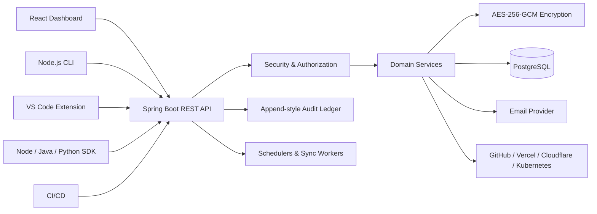

# CryptEnv — Complete Project Information

## 1. Project overview

**CryptEnv** is an end-to-end encrypted secrets-management platform for developers, teams, CI/CD pipelines, and production applications. It replaces scattered plaintext `.env` files and manually maintained provider secrets with one centralized control plane.

The system provides a Spring Boot API, React dashboard, Node.js CLI, VS Code extension, and Node, Java, and Python SDKs.

- **API:** Spring Boot 3.2, Java 17
- **Database:** PostgreSQL 16 with Flyway migrations
- **Encryption:** AES-256-GCM
- **Dashboard:** React, Vite, Tailwind CSS
- **CLI:** Node.js, Commander, OS keyring or encrypted local credential storage
- **SDKs:** Node.js, Java, Python
- **Editor:** VS Code extension
- **Local services:** PostgreSQL and MailHog through Docker Compose
- **Hosted services:** Render API, Vercel dashboard, Neon-compatible PostgreSQL, SMTP providers

## 2. Real-time problem being solved

### Problems in existing workflows

1. **Secret leaks through source control**  
   API keys, database URLs, OAuth secrets, and private tokens are often stored in `.env` files and accidentally committed to Git.

2. **Secrets are duplicated across environments**  
   The same developer, CI system, deployment platform, and editor may maintain separate copies of the same secret.

3. **No access or change history**  
   Teams usually cannot tell who viewed or changed a secret, when it changed, or whether it is still active.

4. **Unsafe manual runtime configuration**  
   Plaintext files may remain on disk, appear in screenshots or shell history, be copied into Docker images, or be exposed in build logs.

5. **Slow rotation and inconsistent synchronization**  
   A changed secret may need to be updated manually in GitHub Actions, Vercel, Cloudflare, Kubernetes, or application configuration.

6. **Weak separation between development and production**  
   Personal credentials can accidentally be used outside the correct workspace or environment.

7. **No unified developer experience**  
   Developers, CI systems, browsers, and applications require separate secret-management workflows.

### CryptEnv's solution

CryptEnv gives applications and teams one encrypted vault that:

- Stores encrypted values instead of plaintext in PostgreSQL.
- Organizes secrets by workspace, project, and environment.
- Authenticates humans and machines separately.
- Injects secrets into child processes only, without creating `.env` files.
- Records audited operations and secret versions.
- Supports secret rotation and recovery of previous versions.
- Exposes the same vault through a web dashboard, CLI, editor, SDKs, and REST API.
- Detects drift and synchronizes supported values to external providers.
- Limits access with roles, protected environments, step-up MFA, invitations, and JIT requests.

## 3. System architecture



### Request flow

1. A client sends a JWT, API key, or authenticated SDK request.
2. Filters perform rate limiting and credential validation.
3. Controllers receive the requested operation.
4. Services verify workspace, project, environment, and role ownership.
5. Secret values are encrypted or decrypted with the workspace key.
6. PostgreSQL stores ciphertext and metadata.
7. Successful operations are recorded in the audit log.

## 4. Main project sections

| Section | Responsibility |
|---|---|
| `cryptenv-core` | Spring Boot backend, REST API, authentication, encryption, authorization, database migrations, audit, integrations, and scheduled jobs |
| `cryptenv-dashboard` | Browser interface for identity, workspaces, secrets, audit, governance, integrations, and administration |
| `cryptenv-cli` | Terminal workflow, runtime environment injection, secret lifecycle, project context, JIT access, and leak scanning |
| `cryptenv-vscode` | VS Code Secrets Explorer, authentication, secret CRUD, copy/insert workflow, and self-hosted backend configuration |
| `cryptenv-sdk/node` | Node.js authentication and secret decryption/loading into `process.env` |
| `cryptenv-sdk/java` | Java SDK for authentication and encrypted secret retrieval |
| `cryptenv-sdk/python` | Python SDK for authentication, secret retrieval, decryption, and `os.environ` loading |
| `docs` | Product assets and documentation resources |
| `docker-compose.yml` | Local PostgreSQL, MailHog, API, and dashboard stack |
| `features.md` | Repository feature roadmap and incomplete/partial feature list |
| `Project.md` | Interview-oriented product brief and architectural explanation |
| `README.md` | Public setup, architecture, security, API, and deployment documentation |

## 5. Backend features

### 5.1 Authentication and account identity

The backend supports:

- Email and password registration.
- BCrypt password storage.
- Email verification using time-limited six-digit codes.
- Login and account lockout protection.
- Short-lived JWT access tokens.
- Rotating refresh tokens with reuse detection.
- Session revocation and sign-out everywhere.
- TOTP MFA and recovery codes.
- Step-up MFA for sensitive operations.
- Forgot-password and reset-password flows.
- Google OAuth sign-in.
- CLI device-code and OAuth-related authentication support.
- API keys for CI/CD and machine access.

Passwords and session credentials are never accepted as a substitute for workspace authorization. API keys are resolved through dedicated authentication logic rather than being stored in the JWT session path.

### 5.2 Workspace organization

CryptEnv is organized into:

```text
Workspace
  └── Project
       └── Environment
            └── Secrets
```

Supported environments include DEVELOPMENT, STAGING, PRODUCTION, and custom environments where the backend model supports them.

A workspace has:

- A name and description.
- An owner.
- Members and workspace roles.
- An encryption key.
- Projects and environments.
- Audit events and provider integrations.

This prevents one user's repository or checkout from becoming the implicit security boundary.

### 5.3 Workspace membership and access control

The access system supports:

- Workspace owner/member relationships.
- Workspace-scoped roles.
- Invitations and membership operations.
- Production and protected-environment write checks.
- Step-up authentication for sensitive actions.
- JIT access requests with justification and a bounded duration.
- JIT approval or denial by authorized workspace users.
- Scheduled expiration of temporary grants.
- Scoped API-key permissions.

Protected environments require elevated authorization rather than relying only on possession of an API key or login token.

### 5.4 AES-256-GCM encryption

Secret values are encrypted before being persisted.

Security characteristics:

- Authenticated encryption with AES-256-GCM.
- A host-provided master encryption key.
- Workspace-specific encryption keys.
- PBKDF2-based `v2:` ciphertext support.
- Per-value salt and unique initialization vector for `v2:` values.
- Additional authenticated data binding to secret/workspace/environment/version identity.
- Envelope-encryption service support for wrapped data keys.
- Compatibility with both legacy and versioned ciphertext formats.
- No plaintext secret values in normal PostgreSQL secret rows.

The master key is environment-controlled and should not be committed to source control. A workspace key is required before secrets can be created or decrypted.

### 5.5 Secret lifecycle

Every secret can include:

- Key name.
- Description.
- Secret type: text, password, API key, and related types.
- Tags.
- Environment and workspace.
- Active/inactive state.
- Expiry timestamp.
- Rotation interval.
- Automatic or manual rotation status.
- Soft-delete state.
- Version number and content fingerprint.

Operations include:

- Create secret.
- Update secret value.
- Reveal secret.
- Delete secret.
- Restore soft-deleted secret.
- Activate or deactivate secret.
- Set or remove expiry.
- Configure rotation interval.
- Enable or disable automatic rotation.
- Generate a random replacement value.
- Roll back to an earlier version.
- View version history.
- Bulk create/update secrets.
- Import and export `.env`, JSON, YAML, Docker, or Kubernetes-style data.

### 5.6 Secret versions and rollback

CryptEnv stores versions when secret values change. It can:

- Record the initial value.
- Increment the version on update or rotation.
- Store author and change reason metadata.
- Restore a previous secret version.
- Compare or inspect version history.
- Use fingerprints to identify whether provider content matches vault content.

### 5.7 Audit ledger

The audit subsystem records important security actions, including authentication, secret access, secret writes, deletion, rollback, role changes, API-key use, and provider operations.

Audit records include:

- Acting user or machine identity.
- Workspace or resource reference.
- Action and timestamp.
- Success or failure status.
- IP address and user-agent where available.
- Hash-chain fields for ledger integrity.

A verification endpoint is intended to confirm the audit hash chain. The dashboard provides filtered audit log views.

### 5.8 Approval workflows

Sensitive operations can be represented by approval requests. This supports a four-eyes review model for changes such as:

- Protected environment writes.
- Secret deletion.
- Secret rotation.
- High-impact administrative changes.

### 5.9 Notifications and automation

The backend has notification, automation, webhook, and event-oriented structures. Supported notification channels include:

- In-app notifications.
- Email.
- Slack or Discord-style webhook destinations.
- Per-user notification preferences.

Automation rules can react to events and execute configured actions with loop protection.

### 5.10 Provider integrations

CryptEnv supports provider integration records and a synchronization worker.

Built provider areas include:

- GitHub Actions secrets.
- Vercel environment variables.
- Cloudflare Workers/Pages secrets.
- Kubernetes secrets.
- Docker and Compose export.
- Optional AWS Secrets Manager support.

A provider sync job can:

- Be queued for a workspace/environment.
- Run asynchronously.
- Retry with backoff.
- Enter a dead-letter state after repeated failure.
- Be retried or replayed.
- Store provider credentials in encrypted form.
- Report sync status to the dashboard.

### 5.11 Drift detection

Drift detection compares the fingerprint of the vault value with the value at an external provider.

It classifies differences as:

- `IN_SYNC`
- `STALE`
- `MODIFIED`
- `MISSING`

Capabilities include:

- Manual drift scans.
- Scheduled scans.
- Environment-specific latest findings.
- Remediation that queues provider synchronization.
- CSV and JSON compliance report exports.
- Optional automated remediation through scheduled jobs.

### 5.12 Leak detection

The CLI and related backend/editor areas support secret-leak detection.

Detection rules can identify:

- AWS access-key patterns.
- GitHub tokens.
- Stripe-style tokens.
- Private keys.
- High-entropy strings.
- Generic credential assignments.

`cryptenv:ignore` and `gitleaks:allow` comments can suppress approved findings.

### 5.13 Security posture

The security-health area summarizes:

- Secret and workspace counts.
- MFA configuration.
- Audit availability.
- Protected-environment indicators.
- Live posture information where the backend exposes it.

A more complete risk score and remediation engine is part of the project roadmap.

## 6. Dashboard features

### Public pages

- Landing page.
- Login.
- Registration.
- Email verification.
- Forgot-password flow.
- Google OAuth callback.
- About page.
- Protected documentation area.

### Authenticated pages

| Page | Purpose |
|---|---|
| Overview | Workspace and vault summary |
| Workspace | Create/manage workspace and environment structure |
| Members | Membership and access administration |
| Secrets | Browse and filter secrets |
| Secret Editor | Create or edit encrypted secrets |
| Secret History | View secret versions and history |
| Secret Rotation | Manage or inspect rotation state |
| Integrations | Configure provider connections |
| Drift | Run and review drift scans |
| Security Health | Security posture and health indicators |
| Notifications | Notification events and preferences |
| Access Requests | JIT access request workflow |
| Access Reviews | Access-certification review page |
| Incidents | Security incident workflow |
| Leaks | Detected leak findings |
| Audit Logs | Filter and inspect audit activity |
| Settings | Account, API-key, notification, and workspace settings |

The dashboard uses an Axios API client and redirects unauthenticated users to `/login`. Access tokens are attached to API requests, and login failures or expired sessions are handled through authentication state.

Some governance and incident pages may still contain static or partial content while their corresponding backend workflows are completed.

## 7. CLI features

### Authentication commands

- `cryptenv register`
- `cryptenv login`
- `cryptenv verify-email`
- `cryptenv forgot-password`
- `cryptenv logout`
- `cryptenv logout --everywhere`
- `cryptenv whoami`
- `cryptenv profile`
- `cryptenv status`
- `cryptenv doctor`

The CLI supports automatic access-token refresh and API-key authentication for CI/CD.

### Project context commands

- `cryptenv init`
- `cryptenv use`
- `cryptenv envs`
- `cryptenv project ls`
- `cryptenv project create`

A project context file named `.cryptenv.json` stores API URL and selected workspace/environment IDs. It does not store secret values.

### Workspace commands

- `cryptenv workspaces ls`
- `cryptenv workspaces create`
- `cryptenv ws ls`
- `cryptenv ws create`

### Secret commands

- List secrets.
- Get/decrypt a secret.
- Create or update a secret.
- Delete a secret.
- Rotate a secret.
- Import `.env`, JSON, or YAML.
- Export secret values securely.
- View versions.
- Roll back to a version.
- Activate/deactivate.
- Soft-delete/restore.
- Set expiry.
- Configure automatic rotation.

### Runtime injection

`cryptenv run` is the main developer protection feature:

1. Resolves workspace and environment context.
2. Fetches the environment's encrypted secret values.
3. Decrypts or receives authorized plaintext values.
4. Merges values into the child process environment.
5. Spawn the application process.
6. Does not create or update a `.env` file.

Example:

```bash
cryptenv run -- npm start
cryptenv run -e 12 -- python manage.py runserver
cryptenv run --dry-run -- npm start
```

### JIT access

- Request protected-environment access.
- Specify justification and duration from 1 to 24 hours.
- Approve or deny requests.
- List pending and active requests.

### Security and developer tools

- Scan directories or files for leaks.
- Scan staged Git changes.
- Install a pre-commit hook.
- Print shell completion scripts.
- Use JSON output and non-zero failure codes for automation.

## 8. VS Code extension features

The extension adds CryptEnv to the VS Code Activity Bar.

Features include:

- Sign in with email/password.
- TOTP/recovery-code MFA login.
- API-key authentication.
- Register and verify accounts.
- Reset passwords.
- View workspace/profile information.
- Create and delete workspaces.
- Set the workspace encryption key.
- Create and delete environments.
- Browse workspaces, environments, and secret names.
- Add, edit, preview, copy, and delete secrets.
- Insert secret names or values at the editor cursor.
- Store credentials in VS Code `SecretStorage`.
- Configure a self-hosted backend URL.
- Automatically refresh access tokens.
- Apply step-up MFA to reveal operations.
- Server-side sign-out and credential cleanup.

The extension does not store secret values in VS Code settings or write them to `.env` files.

## 9. SDK features

### Node SDK

The Node SDK provides:

- Login and initialization.
- Workspace and environment selection.
- Encrypted secret retrieval.
- Local AES-GCM decryption.
- `getAll()` for multiple secrets.
- `load()` to inject values into `process.env`.
- Create, update, and delete operations where supported.
- Token refresh and authentication helpers.

### Java SDK

The Java SDK provides:

- SDK initialization and login.
- Token refresh.
- Workspace-aware secret retrieval.
- Local encrypted-value decryption.
- `get()` and `getAll()` style secret access.

### Python SDK

The Python SDK provides:

- Password/API authentication.
- Workspace and environment selection.
- AES-GCM local decryption.
- `get()`, `get_all()`, and `load()` operations.
- Runtime injection into `os.environ`.
- Secret creation/delete operations where supported.

## 10. Deployment and infrastructure

### Local Docker Compose stack

The Compose configuration starts:

- PostgreSQL 16.
- MailHog SMTP and web UI.
- CryptEnv Spring Boot API.
- React dashboard.

The API runs on port `8080`, the dashboard on `5173`, PostgreSQL on `5432`, and MailHog on `1025/8025`.

### Hosted deployment

Typical production topology:

- React dashboard hosted on Vercel.
- Spring Boot API hosted on Render.
- PostgreSQL hosted on Neon or another managed provider.
- SMTP handled by Brevo, Resend, or another configured provider.

Environment variables cover database credentials, JWT signing, master encryption key, CORS, mail transport, OAuth, and rate limiting.

## 11. Security model summary

CryptEnv uses defense in depth:

- HTTPS and authenticated API requests.
- AES-256-GCM encryption at rest.
- Host-held master key.
- Workspace-specific keys.
- Versioned ciphertext compatibility.
- AAD binding against row identity.
- JWTs with short lifetimes.
- Rotating refresh tokens and session revocation.
- MFA for interactive sensitive operations.
- API-key scoping and expiry.
- Workspace and environment authorization checks.
- Protected-environment/JIT access.
- Per-IP rate limiting.
- Audit logging and hash-chain integrity.
- No plaintext `.env` generation during CLI or SDK runtime injection.

## 12. Technology and repository summary

- **CryptEnv core:** Java 17, Spring Boot, Spring Security, JPA, Flyway.
- **Database:** PostgreSQL 16.
- **Frontend:** React, Vite, Tailwind CSS, React Router.
- **CLI:** Node.js, Commander, keytar-compatible keyring, encrypted credential fallback.
- **Editor:** VS Code API and `SecretStorage`.
- **Node SDK:** JavaScript, Axios, AES-GCM-compatible crypto.
- **Java SDK:** Java Maven package published to Maven Central.
- **Python SDK:** Python package sources in `cryptenv-sdk/python`.
- **Local infrastructure:** Docker Compose, PostgreSQL, MailHog.
- **License:** Apache-2.0.

## 13. Feature status note

The repository contains both production-oriented implementation and planned/partial work. The most reliable shipped areas are the vault, authentication, encryption, runtime injection, CLI, SDKs, VS Code commands, dashboard, audit, provider sync, drift, JIT, and secret lifecycle foundations.

Roadmap-oriented areas may include more complete UI/API scaffolding than production hardening. Items such as passkey support, workload/OIDC identity, full incident lifecycle, AI copilot, Redis-based distributed rate limiting, and complete dashboard coverage should be verified against source and tests before being presented as fully shipped features.
